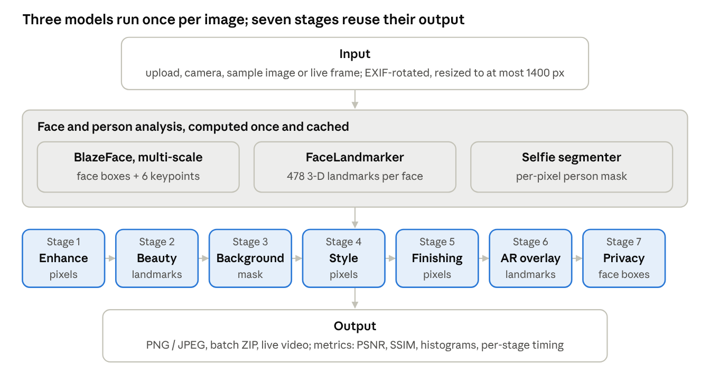

# Implementation details

This is a guided tour of how Face Studio Camera works. For the long version, with worked numeric examples for every feature, see the [Technical Guide (PDF)](Face_Studio_Camera_Technical_Guide.pdf).

---

## 1. The big picture



1. **Input.** A photo is uploaded, taken with the camera, or picked from the samples.
2. **Decode.** Pillow opens it and applies `ImageOps.exif_transpose`, so phone photos aren't sideways. It is then converted to a NumPy array in OpenCV's BGR channel order.
3. **Resize.** Anything larger than 1400 px on its longest side is shrunk with `INTER_AREA`. A 12-megapixel phone photo becomes about 8× smaller, so every later step is about 8× faster.
4. **Analyse once.** Only if an active stage needs them, three MediaPipe models run and their outputs are cached by Streamlit (`st.cache_data`):
   - **BlazeFace** for face boxes and 6 keypoints
   - **FaceLandmarker** for 478 3D points per face
   - **Selfie Segmenter** for a per-pixel "is this the person?" mask
5. **Pipeline.** `pipeline.run_pipeline()` runs the enabled stages in a fixed order and times each one.
6. **Show and measure.** The result appears in a before/after slider, with PSNR, SSIM, histograms and per-stage timings.
7. **Export.** PNG or JPEG download, saved to `saved_images/`, or a ZIP in batch mode.

Because no stage moves pixels geometrically, the face stays in the same place after every stage. That's why landmarks, the mask and face boxes can be computed once and reused.

## 2. Technologies and why we picked them

| Library | Used for | Why |
|---|---|---|
| **Streamlit** | The whole web UI | A full interactive app in pure Python; no HTML or JavaScript needed |
| **OpenCV** | Filters, colour spaces, edges, morphology, drawing, Haar cascade, webcam | The standard computer-vision library, fast C++ under the hood, and what the syllabus uses |
| **NumPy** | Every image is an array; blending, masks, FFT, geometry | Vectorised maths is thousands of times faster than Python loops |
| **MediaPipe (Tasks API)** | Face detection, 478-point mesh, person segmentation | Accurate pre-trained models that run offline on a CPU in milliseconds |
| **Pillow** | Reading uploads (with EXIF rotation), writing PNG/JPEG | OpenCV ignores EXIF orientation |
| **pandas** | Tables, charts, CSV export | Easy to work with in Streamlit |
| **streamlit-webrtc** | Live webcam video in the browser | Streams frames between browser and Python over WebRTC |
| **pytest** | Unit tests | The standard Python test runner |

**Why not Haar cascades for the main app?** Haar (Viola–Jones, 2001) slides hand-made rectangle features over the image. It's fast and good on upright frontal faces, but it struggles with tilted heads and gives no landmarks or calibrated confidence. We kept it as a baseline and measured the difference (Section 8).

## 3. The 7-stage pipeline (`pipeline.py`)

```
1 Enhance → 2 Beauty → 3 Background → 4 Style → 5 Finishing → 6 AR overlay → 7 Privacy
```

| Order | Why |
|---|---|
| Enhance first | Tone fixes should affect everything after them |
| Beauty before Background | Skin smoothing should sample real face pixels, not a blurred border |
| Background before Style | The new backdrop gets the same style as the person |
| Finishing after Style | Vignette and grain are "lens and film" effects on the final look |
| AR after Style | Sunglasses stay sharp instead of being cartoonised |
| Privacy last | Nothing can draw over a hidden face afterwards |

- **Settings** are one dictionary of 22 values (`DEFAULTS`). A **preset** (Portrait Pro, Vintage, Noir, Cartoon Pop, Backdrop, Party Mode, Privacy Safe) is just a small set of changes to it.
- **Lazy getters.** The pipeline receives *functions* for landmarks, the mask and face boxes, and calls them only when a stage needs them. With only brightness switched on, no neural network runs.
- The same pipeline powers the Studio tab, batch mode, the live camera and `benchmark.py`.

## 4. Enhancement (`filters.py`)

| Control | How it works |
|---|---|
| Brightness | Add a value to the V channel of HSV, so colours don't wash out |
| Contrast | `F = 259(c+255) / (255(259−c))`, then `out = F·(in − 128) + 128` |
| Saturation | Multiply the HSV S channel by `(1 + value/100)` |
| Gamma | `s = 255·(r/255)^(1/γ)`, precomputed as a 256-entry lookup table (`cv2.LUT`) |
| Sharpness | Unsharp mask: `out = (1+a)·I − a·Gaussian(I)` |
| Warmth | +red / −blue (or the reverse to cool) |
| Auto-enhance | CLAHE (8×8 tiles, clip limit 2.0) on the L channel of LAB, then +12 saturation |

Pixels are `uint8`, so 250 + 10 would wrap around to 4. Every filter does its maths in `int16` or `float32` and clips back to 0–255.

## 5. Beauty (`face_effects.py`)

- **Skin mask:** fill the 36-point face-oval polygon, cut out the eyes, eyebrows and lips (dilated a little for safety), and feather the edges with a Gaussian blur. All sizes are fractions of the distance between the eyes, so it works for any face size.
- **Skin smoothing:** a **bilateral filter**, which averages neighbours weighted by both distance and colour similarity, so edges like the jaw line survive. It is blended in only where the skin mask is on.
- **Lip tint and eye colour:** recolour in HSV by replacing the hue and saturation but keeping V (brightness), so texture and shine are preserved. Eyes use MediaPipe's iris points, clipped to the eye outline so eyelids aren't tinted.

## 6. Background effects

- The **selfie segmenter** returns a person-probability mask (0–1 per pixel). Google's model outputs `[background, person]`, so we take the **last** mask. The original version of this project took index 0 (the background) by mistake; we fixed that.
- The mask is **feathered** (Gaussian blur), then used for **alpha compositing**: `O = α·I + (1 − α)·B`.
- B can be a blurred copy (portrait mode), a solid colour, an uploaded photo (scaled to cover the frame and centre-cropped), or a greyscale copy (colour splash).

## 7. Styles, AR overlays and privacy

**Styles (13).** Sepia (a colour matrix), noir (CLAHE + contrast), cartoon (bilateral filter + colour quantisation + adaptive-threshold edges), pencil sketch (colour-dodge blend), watercolour and oil paint (edge-preserving filters), emboss (a 3×3 kernel), Canny edges, a thermal colour map, warm/cool tones and greyscale. **Vignette:** multiply by a 2D Gaussian built as the outer product of two 1D Gaussians. **Grain:** seeded Gaussian noise.

**AR overlays** are drawn in a **face-local coordinate frame**:

- origin = the midpoint between the eye centres
- unit `d` = the distance between the eyes
- `e1` = the direction along the eye line, `e2` = perpendicular (toward the chin)
- a point `(u, v)` maps to `origin + d·(u·e1 + v·e2)`

So sunglasses (lenses at `u = ±0.5`), a party hat (based on forehead landmark 10), a moustache (between landmarks 2 and 0, as wide as the mouth) and a cat face automatically follow the face's position, size and tilt. They're drawn with OpenCV shapes plus an alpha map, so no image files are needed.

**Privacy** uses the face boxes (padded 25%):

- **Blur:** a strong Gaussian, applied twice.
- **Pixelate:** shrink so there are about 12 blocks across the face, then enlarge with nearest-neighbour interpolation.
- **Eye bar:** a black rotated rectangle placed from the two eye keypoints.
- **Solid:** a flat dark fill.

Each effect is blended through a feathered ellipse so it's face-shaped.

## 8. Face analysis (`face_utils.py`, `face_effects.py`)

**Multi-scale detection.** BlazeFace short-range shrinks the whole frame to 128×128, so in a group photo a 40 px face becomes about 6 px and is missed. We also run it on overlapping **2×2, 3×3 and 4×4 tiles** (25% overlap, 30 passes in total), keep tile detections with confidence ≥ 0.6, map them back to the full image, and merge duplicates with **non-maximum suppression**. NMS drops a box if its IoU with a better box is above 0.3, or if it lies more than 60% inside one. Live video uses a single pass for speed.

**Two-stage mesh.** FaceLandmarker has the same small-face problem, so any detected face without a mesh is cropped at 2× its box, enlarged to at least 384 px, landmarked, and mapped back.

**Head pose.** Build the head's own axes from 3D landmarks with **Gram–Schmidt**:

- `x` = eye corner 33 → 263
- `y` = forehead 10 → chin 152, with its x-component removed
- `z = x × y`

Then:

- `yaw = atan2(−z_x, z_z)`
- `pitch = atan2(z_y, √(z_x² + z_z²))`
- `roll = atan2(x_y, x_x)`

(We tried `cv2.solvePnP` with a generic 3D head first, but it reported −36° pitch on a face looking straight at the camera.)

**Blinks.** The eye aspect ratio is `EAR = (|p2−p6| + |p3−p5|) / (2|p1−p4|)` over 6 eye points. Below 0.20 the eye counts as closed, and a blink is counted after at least 2 closed frames followed by an open one. The **mouth aspect ratio** is the inner-lip gap divided by the mouth width; above 0.35 means the mouth is open.

**Haar vs MediaPipe experiment (`evaluation.py`).** Each test image is degraded 12 ways (rotation 15/30/45°, gamma 3/5/0.3, noise σ 25/50, 15 px blur, 40% downscale, mirror). All three detectors run on every version, and we record faces found, extra boxes and time.

## 9. Measuring quality (`metrics.py`)

| Metric | Formula / meaning |
|---|---|
| PSNR | `10·log10(255² / MSE)` dB; higher = more similar |
| SSIM | Compares brightness, contrast and structure in 11×11 Gaussian windows; 1 = identical |
| Entropy | `−Σ p·log2 p` over the histogram (bits of information) |
| Sharpness | Variance of the Laplacian |
| Colourfulness | Hasler & Süsstrunk (2003) |

Lesson learned: greyscale scores SSIM 1.000 because SSIM only looks at brightness. PSNR and SSIM measure **how much** an image changed, not how good it looks.

## 10. IPCV Lab (`ipcv_lab.py`)

| Topic | Implementation |
|---|---|
| Colour spaces | RGB, HSV, LAB and YCrCb channels shown side by side |
| Histograms | Global `equalizeHist` vs CLAHE with adjustable clip and tiles |
| Noise & denoising | Gaussian / salt-and-pepper noise, then mean, Gaussian, median, bilateral or non-local means, with PSNR before and after |
| Edges | Sobel, Prewitt, Laplacian, Canny |
| Thresholding | Otsu, adaptive Gaussian, manual |
| Morphology | Erosion, dilation, opening, closing, gradient, top-hat |
| Frequency domain | FFT → Butterworth low/high-pass `H = 1/(1 + (D/D0)^(2n))` → inverse FFT |
| Geometry | Rotation + scale with `warpAffine`, flips |

## 11. Live video and batch

- **Browser:** streamlit-webrtc sends webcam frames to Python; `recv()` converts each to a NumPy array, runs `LiveProcessor.process()`, and sends it back. `async_processing=True` keeps the UI responsive.
- **Desktop:** `live_camera.py` uses `cv2.VideoCapture` + `cv2.imshow` + `cv2.waitKey` for keyboard control. It's the most reliable option for a demo.
- **FPS** = 30 ÷ (total time of the last 30 frames), reset when the effect changes.
- **Batch:** processes every uploaded photo with the current pipeline and builds the ZIP in memory (`zipfile` + `BytesIO`).

## 12. Engineering details

- **Presets moving sliders:** each slider's value lives in `st.session_state` (keys like `s_brightness`). Streamlit won't let code change a slider after it's drawn, so preset buttons use `on_click` callbacks, which run before the page redraws.
- **Before/after slider:** about 40 lines of HTML, CSS and JavaScript in `components.html`, with two stacked images and a draggable clip width.
- **Model downloads** are atomic: each file downloads to `.part` and is renamed only when complete, so a broken download can't crash the app later.
- **`requirements.txt` has no OpenCV line** because MediaPipe already installs `opencv-contrib-python`; listing another OpenCV package would create two clashing copies of `cv2`.
- **Tests:** 8 pytest tests, plus `check_setup.py`, which checks packages, models, every feature and the webcam.

## 13. Known limitations

- Even with tiling, 4 of 7 small, dark faces in one group photo were missed, and tiling can add a few false boxes on very noisy images.
- Segmentation edges soften around fine hair.
- Head-pose pitch has a bias of about −12° on a frontal face, so it's best for relative movement.
- Our detector test set is small (8 images, 20 faces), so the numbers are indicative.
- Online hosting works for everything except `live_camera.py`; the browser live tab would also need STUN/TURN servers.
